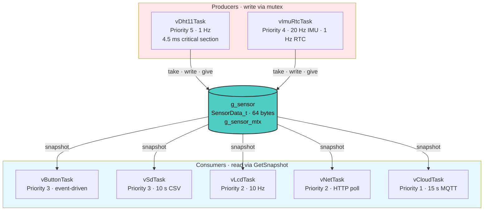

# STM32F411 FreeRTOS Cloud Logger

*Multi-sensor data logger with LCD, MicroSD, ThingSpeak, and a local HTTP dashboard built on FreeRTOS and HAL.*

## Project Overview

A complete embedded data-logging system built around the **STM32F411CE** Cortex-M4 running at 100 MHz, with **FreeRTOS** managing seven concurrent tasks on a single core.

The system reads three sensors:

- **DHT11** — temperature and humidity
- **MPU6050** — 3-axis accelerometer and gyroscope
- **DS3231** — real-time clock with battery backup

and routes their data to four independent outputs:

- **LCD 16×2** — live values in four switchable display modes
- **MicroSD card** — CSV log appended every 10 seconds via FatFS
- **ThingSpeak cloud** — MQTT publish over WiFi through an ESP8266
- **Local HTTP dashboard** — live web page at `http://192.168.2.10` served by a W5500 Ethernet controller

Two push buttons handle mode switching and on-demand snapshot printing. All sensor data flows through a single shared `SensorData_t` struct protected by one mutex.

This is a FreeRTOS + HAL rewrite of my earlier [STM32_MicroSD_Cloud_Logger](https://github.com/rubin-khadka/STM32_MicroSD_Cloud_Logger) (STM32F103, bare-metal, 72 MHz) project. The port to FreeRTOS was necessary because WiFi connection and MQTT publish took 5–20 seconds on the F103 and blocked the entire CPU, freezing the LCD and stopping all sensor reads. On FreeRTOS, those slow operations run in a low-priority task while everything else keeps running normally.

<!--  -->

## Video Demonstration
*Todo*

## Pin Configuration

| Component | STM32 Pin(s) | Notes |
| :--- | :--- | :--- |
| DHT11 | PB0 | 1-Wire, open-drain + pull-up |
| MPU6050 | PB10 (SCL), PB3 (SDA) | I2C2 @ 400 kHz, address 0x69 |
| DS3231 | PB10 (SCL), PB3 (SDA) | I2C2 @ 400 kHz, address 0x68 |
| LCD 16×2 (PCF8574) | PB8 (SCL), PB9 (SDA) | I2C1 @ 100 kHz, address 0x27 |
| MicroSD | PA4 (CS), PA5 (SCK), PA6 (MISO), PA7 (MOSI) | SPI1 @ 3.125 MHz |
| W5500 | PA8 (CS), PA11 (RST), PB13 (SCK), PB14 (MISO), PB15 (MOSI) | SPI2 @ 12.5 MHz |
| ESP8266 | PA9 (TX), PA10 (RX) | USART1 @ 115200, RX DMA |
| UART Debug | PA2 (TX), PA3 (RX) | USART2 @ 115200, TX DMA |
| Button 1 (Mode) | PA0 | EXTI0, falling edge, pull-up |
| Button 2 (Snapshot) | PA1 | EXTI1, falling edge, pull-up |

> **Note:** MPU6050 and DS3231 share I2C2 at different addresses. The LCD is on its own I2C1 because the PCF8574 backpack is limited to 100 kHz.

## Project Schematic

*Full wiring diagram.*

## Free RTOS

## FreeRTOS Task Design

## Project Status
- **Status**: Complete
- **Version**: v1.0
- **Last Updated**: November 2026

## Contact
**Rubin Khadka Chhetri**  
📧 rubinkhadka84@gmail.com  
🐙 GitHub: https://github.com/rubin-khadka

