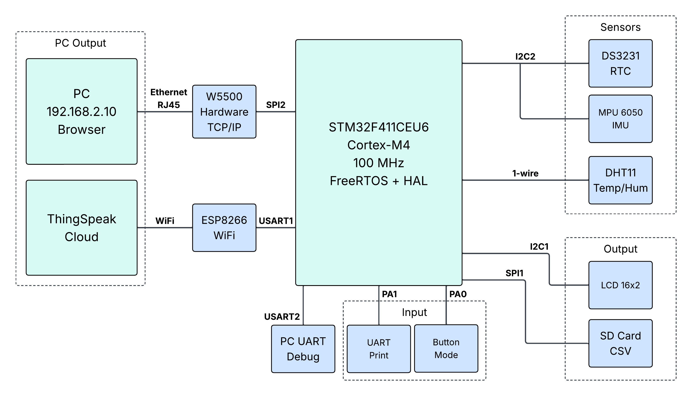
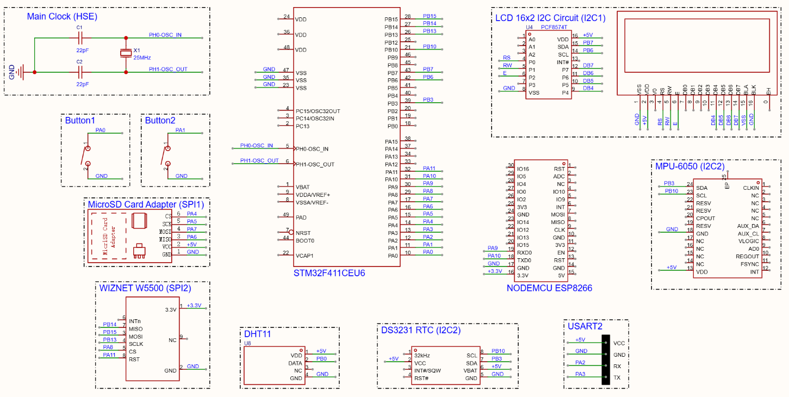
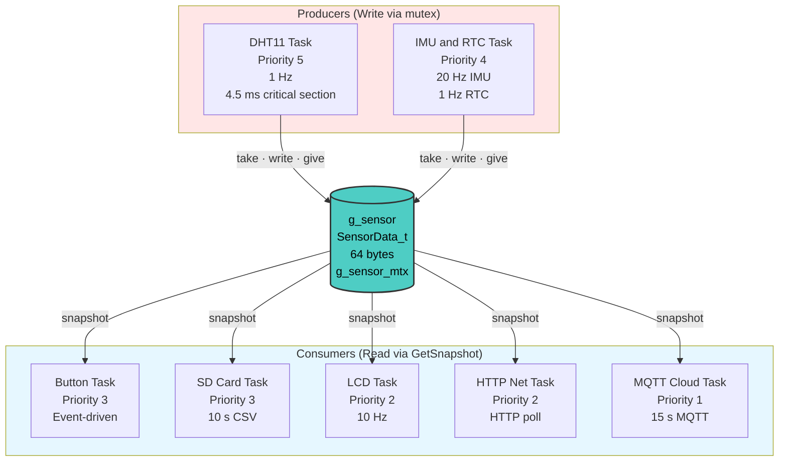

# STM32F411 FreeRTOS Cloud Logger

*Multi-sensor data logger with LCD, MicroSD, ThingSpeak, and a local HTTP dashboard built on FreeRTOS and HAL.*

[](https://www.st.com/en/microcontrollers-microprocessors/stm32f411ce.html)
[](https://www.freertos.org/)
[](https://mqtt.org/)
[](https://www.espressif.com/en/products/socs/esp8266)
[](https://www.wiznet.io/product-item/w5500/)

## Project Overview

A complete embedded data-logging system built around the **STM32F411CE** Cortex-M4 running at 100 MHz, with **FreeRTOS** managing seven concurrent tasks on a single core.

The system reads three sensors:

- **DHT11**: temperature and humidity
- **MPU6050**: 3-axis accelerometer and gyroscope
- **DS3231**: real-time clock with battery backup

and routes their data to four independent outputs:

- **LCD 16×2**: live values in four switchable display modes
- **MicroSD card**: CSV log appended every 10 seconds via FatFS
- **ThingSpeak cloud**: MQTT publish over WiFi through an ESP8266
- **Local HTTP dashboard**: live web page at `http://192.168.2.10` served by a W5500 Ethernet controller

Two push buttons handle mode switching and on-demand snapshot printing. All sensor data flows through a single shared `SensorData_t` struct protected by one mutex.

This is a FreeRTOS + HAL rewrite of my earlier [STM32_MicroSD_Cloud_Logger](https://github.com/rubin-khadka/STM32_MicroSD_Cloud_Logger) (STM32F103, bare-metal, 72 MHz) project. The port to FreeRTOS was necessary because WiFi connection and MQTT publish took 5 to 20 seconds on the F103 and blocked the entire CPU, freezing the LCD and stopping all sensor reads. On FreeRTOS, those slow operations run in a low-priority task while everything else keeps running normally.


*System Architecture Diagram*

## Demonstrations

### System Overview

https://github.com/user-attachments/assets/2bd0616f-c514-4877-bf63-92e6d34c87f9

*LCD cycling through four display modes via button press while the system logs to MicroSD and publishes to ThingSpeak.*

### Local HTTP Dashboard (W5500)

https://github.com/user-attachments/assets/bd251da6-e12e-43f2-9d44-98a6837efc76

*Live values at `http://192.168.2.10` updating every second as the board is tilted , served over a direct Ethernet link with no router.*

### Cloud Dashboard (ThingSpeak)

https://github.com/user-attachments/assets/ce27930b-be80-432d-b53d-0e36456c4ef7

*Both ThingSpeak channels receiving data every 15 s over WiFi. Note the DHT11 channel chart growing in real time.*

## Project Schematic



*Schematic Diagram*

## Pin Configuration

| Component | STM32 Pin(s) | Notes |
| :--- | :--- | :--- |
| DHT11 | PB0 | 1-Wire, open-drain + pull-up |
| MPU6050 | PB10 (SCL), PB3 (SDA) | I2C2 @ 400 kHz, address 0x69 |
| DS3231 | PB10 (SCL), PB3 (SDA) | I2C2 @ 400 kHz, address 0x68 |
| LCD 16×2 (PCF8574) | PB8 (SCL), PB9 (SDA) | I2C1 @ 100 kHz, address 0x27 |
| MicroSD | PA4 (CS), PA5 (SCK), PA6 (MISO), PA7 (MOSI) | SPI1 @ 3.125 MHz |
| W5500 | PA8 (CS), PA11 (RST), PB13 (SCK), PB14 (MISO), PB15 (MOSI) | SPI2 @ 12.5 MHz |
| ESP8266 | PA9 (TX), PA10 (RX) | USART1 @ 115200, RX DMA |
| UART Debug | PA2 (TX), PA3 (RX) | USART2 @ 115200, TX DMA |
| Button 1 (Mode) | PA0 | EXTI0, falling edge, pull-up |
| Button 2 (Snapshot) | PA1 | EXTI1, falling edge, pull-up |

> **Note:** MPU6050 and DS3231 share I2C2 at different addresses. The LCD is on its own I2C1 because the PCF8574 backpack is limited to 100 kHz.

## FreeRTOS Task Design



| Task | Priority | Period | Role |
| :--- | :-: | :--- | :--- |
| DHT11 Task | 5 | 1 s | DHT11 sensor read |
| IMU and RTC Task | 4 | 50 ms / 1 s | MPU6050 at 20 Hz, DS3231 at 1 Hz |
| Button Task | 3 | event | EXTI-driven, debounce + cooldown |
| SD Card Task | 3 | 10 s | CSV row append via FatFS |
| LCD Task | 2 | 100 ms | Four display modes |
| HTTP Net Task | 2 | 10 ms | W5500 HTTP server poll |
| MQTT Cloud Task | 1 | 15 s | ESP8266 + ThingSpeak MQTT |

All sensor data flows through one shared `SensorData_t` struct protected by `g_sensor_mtx`. Producers take the mutex briefly to write their fields; consumers copy the struct under lock then use their private copy. No bus mutexes are needed because every I2C, SPI, and UART bus has exactly one owner task.

## Cloud Connectivity (ThingSpeak)

Sensor data is published to two ThingSpeak channels over MQTT 3.1.1, sent through an ESP8266 module connected to USART1.

| Channel | ID | Fields | Update Rate |
| :--- | :-: | :--- | :-: |
| DHT11 | 3569863 | field1 = temperature (°C), field2 = humidity (%) | 15 s |
| IMU | 3569865 | field1-3 = accel (g), field4-6 = gyro (°/s) | 15 s |

Both channels publish in the same 15 second cycle, so their timestamps stay aligned. This results in about 11,520 messages per day.

The MQTT protocol is implemented from scratch in `mqtt.c`, with no external library. CONNECT and PUBLISH packets are constructed manually with the correct fixed header, variable-length remaining-length encoding, and payload structure.

## Local HTTP Dashboard (W5500)

A W5500 Ethernet controller on SPI2 serves a live web dashboard at `http://192.168.2.10`. The page loads once (~2.4 KB) and updates sensor values every second via AJAX (`fetch('/api/data')` returns ~200 bytes of JSON per request), so the browser never does a full reload.

| Endpoint | Response |
| :--- | :--- |
| `GET /` | HTML dashboard (dark theme, live sensor cards) |
| `GET /api/data` | JSON: temperature, humidity, accel x/y/z, gyro x/y/z, RTC date/time |

The HTTP server runs in `vNetTask` on socket 0, port 80. It uses polling rather than interrupts: socket status is checked every 10 ms, which is invisible at browser request rates. A binary semaphore serializes `USART2_Printf` calls across tasks; there are no bus mutexes.

Unlike the ThingSpeak cloud path, this works entirely without internet. Just a direct Ethernet cable to a PC set to `192.168.2.100/24`.

## Data Output

### CSV (MicroSD card)

File: `sensdata.csv`, updated every 10 seconds.

```csv
DateTime,DHT11_C,DHT11_%,AX_g,AY_g,AZ_g,GX_dps,GY_dps,GZ_dps
2026-11-08 14:30:05,24.5,54.0,-0.030,0.020,0.960,0.00,0.00,2.00
2026-11-08 14:30:15,24.5,54.0,-0.031,0.019,0.961,0.00,0.00,1.99
```

## Related Projects

- [STM32_MicroSD_Cloud_Logger](https://github.com/rubin-khadka/STM32_MicroSD_Cloud_Logger) — original F103 bare-metal version of this project
- [STM32_OTA_Bootloader_W5500](https://github.com/rubin-khadka/STM32_OTA_Bootloader_W5500) — Ethernet OTA firmware update system
- [STM32_OTA_Bootloader_ESP8266](https://github.com/rubin-khadka/STM32_OTA_Bootloader_ESP8266) — WiFi OTA variant

## Resources

- [STM32F411 Datasheet](https://www.st.com/resource/en/datasheet/stm32f411ce.pdf)
- [STM32F411 Reference Manual (RM0383)](https://www.st.com/resource/en/reference_manual/rm0383-stm32f411xce-advanced-armbased-32bit-mcus-stmicroelectronics.pdf)
- [FreeRTOS Kernel Documentation](https://www.freertos.org/Documentation/RTOS_book.html)
- [DHT11 Datasheet](https://www.mouser.com/datasheet/2/758/DHT11-Technical-Data-Sheet-Translated-Version-1143054.pdf)
- [MPU6050 Datasheet](https://invensense.tdk.com/wp-content/uploads/2015/02/MPU-6000-Datasheet1.pdf)
- [DS3231 Datasheet](https://www.analog.com/media/en/technical-documentation/data-sheets/ds3231.pdf)
- [WIZnet W5500 Datasheet](https://cdn.sparkfun.com/datasheets/Dev/Arduino/Shields/W5500_datasheet_v1.0.2_1.pdf)
- [ESP8266 AT Command Set](https://www.espressif.com/sites/default/files/documentation/4a-esp8266_at_instruction_set_en.pdf)
- [MQTT 3.1.1 Specification](https://docs.oasis-open.org/mqtt/mqtt/v3.1.1/os/mqtt-v3.1.1-os.html)
- [FatFs Documentation](http://elm-chan.org/fsw/ff/00index_e.html)

## Project Status
- **Status**: Complete
- **Version**: v1.0
- **Last Updated**: November 2026

## Contact
**Rubin Khadka Chhetri**  
📧 rubinkhadka84@gmail.com <br>
🐙 GitHub: https://github.com/rubin-khadka

